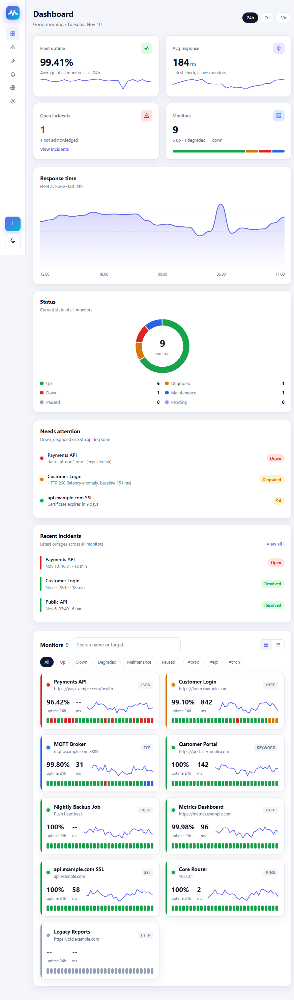

# MyAppsUptime

Self-hosted uptime and SLA monitoring for your apps.
Python (FastAPI) backend + Angular frontend, shipped as **one Docker image**.



## Why MyAppsUptime (vs Uptime Kuma)

| Feature | Uptime Kuma | MyAppsUptime |
|---|---|---|
| HTTP, keyword, TCP, ping, DNS, push | Yes | Yes |
| JSON assertion (`data.status == ok`) | Yes | Yes |
| SSL expiry tracking | Yes | Yes |
| Status pages, maintenance windows | Yes | Yes |
| **SLA target + error budget per monitor** | No | Yes |
| **Smart latency anomaly detection** | No | Yes |
| **Monitor dependencies** (no alert storm when parent is down) | No | Yes |
| **Incident acknowledge + owner + note** | No | Yes |
| **Alert routing by tag** (team channels) | No | Yes |
| **Projects** (group monitors, members get their project's alerts) | No | Yes |
| **Users and roles** (admin / member) | Single user | Yes |
| Microsoft Teams and email alerts | Yes | Yes |
| **MTTR and P95 response time** | No | Yes |
| Repeat alert while down | Yes | Yes |
| Prometheus `/metrics` | Yes | Yes |
| Badges (SVG) | Yes | Yes |
| Backup / restore (JSON) | Yes | Yes |
| Daily database backup (kept 7 days) | No | Yes |
| Alert only after N failed checks in a row | Retries | Yes |
| SSL and domain expiry warnings (30, 14, 7 days) | SSL only | Yes |
| Status page: custom domain, logo, incident notes | Yes | Yes |
| Shrink database, clear statistics, DNS cache | Yes | Yes |
| Light and dark theme | Yes | Yes |
| REST API with OpenAPI docs | Limited | Yes (`/docs`) |
| **Private locations** (probe in your home/office LAN) | No | Yes |
| Docker container status | Yes | Yes |
| amd64 and arm64 images (Raspberry Pi) | Yes | Yes |

## Quick start (Docker)

```bash
docker compose up -d --build
```

Open http://localhost:8000

Data is stored in the `myappsuptime-data` Docker volume.

## First sign-in

- User name `admin`, password `admin`. You must change the password right away.
- Then open **Settings** to set everything up. All configuration lives there.

| Settings page | What you set |
|---|---|
| Tenants | Super admin only: add, rename, disable or delete tenants |
| General | Auto refresh (default 5 seconds), app URL for links in alerts, how long to keep logs (default 1 year), alert after N failed checks (default 3), expiry warning days (default 30, 14, 7), database shrink / clear, server backup and DNS cache (super admin) |
| Notifications | Teams, email, Telegram, Discord, Google Chat, ntfy, Slack or webhook channels, and the email (SMTP) server |
| Teams | Teams, their members and their services (monitors) |
| Users | Add users, set role, reset a password |
| Security | Your account and password |
| Backup | Export and import as JSON |
| About | Version and GitHub link |

**Tenants**

Tenant > Team > Service.

- The default tenant is `admin`. Its first user is the super admin.
- The super admin manages all tenants and can open any tenant from the sidebar.
- Each tenant has its own database file: `tenants/<tenant>.db`, next to the main database (change with `TENANT_DATA_DIR`).
- Each tenant can have one admin. User names are unique across all tenants.
- A deleted tenant's file is moved to `tenants/deleted/`.

**Roles**

| Role | Can do |
|---|---|
| Super admin | Everything, in every tenant |
| Admin | Everything inside their own tenant |
| Member | Sees only their teams, can acknowledge incidents and run a check |

**How alerts reach the right people**

1. Put monitors in a team (Settings > Teams, or the Team field on the monitor).
2. Add users as team members. With "Email members" on, they get an email when a monitor goes down or recovers.
3. Optional: add a Teams channel and tick the team, so the alert also goes to that Teams channel.

**Forgot password**

- With email set up (SMTP + app URL), use "Forgot password?" on the sign-in page. The link works once, for 30 minutes.
- An admin can set a new password in Settings > Users.
- If no admin can sign in, run on the server:

```bash
cd backend
python -m app.reset_password admin 'NewPassword123'
```

In Docker: `docker exec -it myappsuptime python -m app.reset_password admin 'NewPassword123'`

**Upgrading** keeps your data. On start, every database (main and each tenant) is updated:

1. New tables and columns are added.
2. Pending migrations run once, in order. They are listed in `backend/app/database.py` (`MIGRATIONS`) and tracked in the `schema_migrations` table.
3. Before a migration runs, the database file is copied to `<name>.db.v<old version>.bak`.

To add a migration for a new feature: append a step with the next number. Never change a released step.

**Database backup**

- Daily, on by default. Kept 7 days (Settings > General > Server).
- Saved in `backups/YYYY-MM-DD/` next to the main database (change with `BACKUP_DIR`).
- Restore: stop the app, copy `main.db`, `tenants/*.db` and `secret.key` back, start the app.

**Status page on your own domain**

1. Settings > Status pages > Edit > set "Custom domain" (for example `status.example.com`).
2. Point the domain's DNS to this server.
3. Put HTTPS on your reverse proxy (nginx, Traefik, Caddy). Visitors to the domain see the status page.

**Public incident note**: on the Incidents page, "Acknowledge" has a public note. It is shown on status pages. The internal note stays private.

### Without compose

```bash
docker build -t myappsuptime:latest .
docker run -d --name myappsuptime -p 8000:8000 -v myappsuptime-data:/data myappsuptime:latest
```

### Ready-made image

Every push to `main`, `develop`, `release/*`, `feature/*` and every `v*` tag builds and publishes an image to GitHub Container Registry. Pull requests do not build images. Time stamps are UTC.

| Branch | Tags |
|---|---|
| any | `latest` (newest build of any branch) |
| `main` | `lts`, `20261112-1041` |
| `develop` | `beta`, `beta-20261112-1041` |
| `release/1.2.0` | `1.2.0`, `1.2.0-20261112-1041` |
| `feature/login` | `alpha-login`, `alpha-login-20261112-1041` |
| git tag `v17` | `v17` |

```bash
docker run -d --name myappsuptime -p 8000:8000 -v myappsuptime-data:/data ghcr.io/thangaduraiponnusamy/myappsuptime:latest
```

| Image | What |
|---|---|
| `ghcr.io/thangaduraiponnusamy/myappsuptime` | Server (UI + API) |
| `ghcr.io/thangaduraiponnusamy/myappsuptime-probe` | Probe for private locations. See [docs/USAGE.md](docs/USAGE.md#13-private-locations-probes) |

Both images are built for amd64 and arm64, with the same tags. `DB_PASSWORD` works only on amd64.

## Environment variables

| Variable | Default | Meaning |
|---|---|---|
| `API_TOKEN` | empty | Optional token for scripts: `Authorization: Bearer <token>` (acts as admin) |
| `DB_PASSWORD` | empty | Encrypts the whole database file (SQLCipher). Empty = plain database |
| `DB_PASSWORD_FILE` | empty | Read `DB_PASSWORD` from this file (Docker/Kubernetes secrets) |
| `SECRET_KEY` | empty | Key used to encrypt the SMTP password and webhook URLs. If empty, `secret.key` is created next to the DB |
| `SECRET_KEY_FILE` | `secret.key` next to the DB | Where the key file is kept when `SECRET_KEY` is not set |
| `APP_URL` | empty | App address for alert buttons and links, if not set in Settings > General |
| `TZ` | `UTC` | Time zone for alerts (for example `Asia/Kolkata`), if not set in Settings > General |
| `SESSION_DAYS` | `7` | How long a sign-in lasts |
| `DATABASE_URL` | `sqlite:////data/myappsuptime.db` | SQLAlchemy database URL |
| `TENANT_DATA_DIR` | `tenants/` next to the main DB | Where tenant database files live |
| `BACKUP_DIR` | `backups/` next to the main DB | Where daily backups are saved |
| `CORS_ORIGINS` | `http://localhost:4200` | Only for local dev |

## Local testing (without Docker)

Runs the API and the built UI together on one port. Commands are for Git Bash on Windows.

**First time only** (install backend and frontend dependencies, build the UI):

```bash
cd MyAppsUptime/backend
python -m venv .venv
.venv/Scripts/python.exe -m pip install -r requirements.txt

cd ../frontend
npm install
NG_CLI_ANALYTICS=false npx ng build
```

**Start the app:**

```bash
cd MyAppsUptime/backend
STATIC_DIR=../frontend/dist/myappsuptime-ui/browser .venv/Scripts/python.exe -m uvicorn app.main:app --port 8000
```

Open http://127.0.0.1:8000. Stop with `Ctrl+C`.

| Task | Command |
|---|---|
| Rebuild UI after frontend changes | `cd ../frontend && NG_CLI_ANALYTICS=false npx ng build` (then restart the app) |
| API docs | http://127.0.0.1:8000/docs |
| Local data file | `backend/myappsuptime.db` |
| Start fresh | Stop the app, delete `backend/myappsuptime.db`, start again |
| "Port 8000 already in use" | Another copy is running. Stop it, or use `--port 8001` |
| Run backend tests | `.venv/Scripts/python.exe -m pip install -r requirements-dev.txt && .venv/Scripts/python.exe -m pytest -q` |
| Run browser tests (UI built first) | From the repo root: `pip install -r e2e/requirements.txt && python -m playwright install chromium && python -m pytest e2e -q` |
| Run a probe locally | From the repo root: `SERVER_URL=http://127.0.0.1:8000 PROBE_TOKEN='<token>' python -m probe` |

On Linux or macOS use `.venv/bin/python` instead of `.venv/Scripts/python.exe`.

## Local development (live reload)

Backend:

```bash
cd backend
.venv/Scripts/python.exe -m uvicorn app.main:app --reload --port 8000
```

Frontend (second terminal):

```bash
cd frontend
npm start
```

Open http://localhost:4200. UI changes reload automatically.

## Sample UI (no backend needed)

| File | Shows |
|---|---|
| [preview/index.html](preview/index.html) | Overview dashboard (add `#dark` for dark mode) |
| [preview/monitor.html](preview/monitor.html) | Monitor details, SLA, chart |
| [preview/status.html](preview/status.html) | Public status page |

Screenshots: [ui-overview.png](preview/ui-overview.png), [ui-overview-dark.png](preview/ui-overview-dark.png), [ui-monitor.png](preview/ui-monitor.png), [ui-status.png](preview/ui-status.png).

## Folder layout

| Path | What |
|---|---|
| `backend/` | FastAPI app, checks, scheduler, models |
| `frontend/` | Angular 18 app |
| `preview/` | Static sample pages and screenshots |
| `branding/` | Logo files (SVG) and brand sheet |
| `probe/` | Probe for private locations |
| `e2e/` | Browser tests (Playwright) |
| `docs/USAGE.md` | How to use the app |
| `Dockerfile` | Builds UI + API into one image |
| `Dockerfile.probe` | Builds the probe image |

How to use it: [docs/USAGE.md](docs/USAGE.md)

## License

MIT. See [LICENSE](LICENSE).
